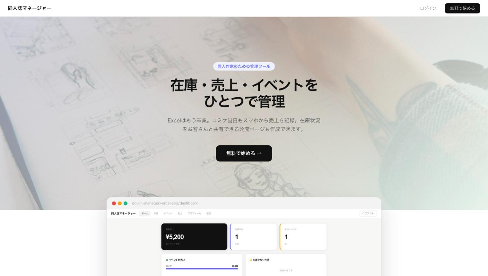
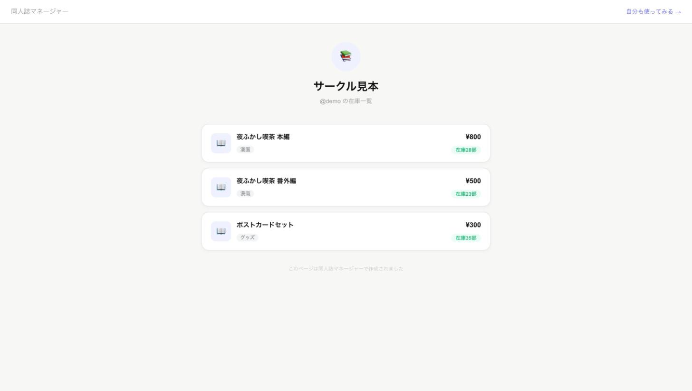

# 同人誌マネージャー

同人作家のための、在庫・売上・イベントの管理ツール。即売会の当日も、スマホから売上を記録できます。

**公開中:** https://doujin-manager.vercel.app ・ 公開在庫ページの見本: https://doujin-manager.vercel.app/u/demo



## できること

- **作品**: タイトル・ジャンル・頒布価格・在庫数を登録
- **イベント**: 参加する即売会(日付・会場)を登録
- **売上**: 通常の記録に加えて、当日用の「ライブ」モード — 作品ごとにタップで部数を数えて、最後にまとめて保存。保存すると在庫が自動で減る
- **収支**: イベントごとに参加費・交通費などの経費を入れて、売上との差を見る
- **公開在庫ページ** (`/u/ユーザー名`): 在庫と価格をお客さんに見せるページ。SNSにURLを貼るだけ



## しくみ

- Next.js (App Router) + Supabase (Auth / Postgres) + Vercel
- データの守り方は Postgres の行レベルセキュリティ (RLS):
  - 売上・イベント・経費 — 本人だけが読み書きできる
  - 作品・プロフィール — 誰でも読める(公開在庫ページのため)。書けるのは本人だけ
- 在庫を減らす処理は `decrement_stock(work_id, qty)` という DB 関数で、0 未満にはならない

## 動かす

```bash
npm install
cp .env.local.example .env.local   # Supabase の URL と anon キーを入れる
npm run dev
```

http://localhost:3000 を開く。

---

**English:** Inventory, sales and event manager for Japanese doujinshi (self-published comics) creators. Record sales on your phone at a convention (tap-to-count "live" mode, stock decrements automatically), track per-event costs, and share a public stock page. Next.js + Supabase (RLS: sales/events/costs private per user; works/profiles publicly readable for the share page) + Vercel.
